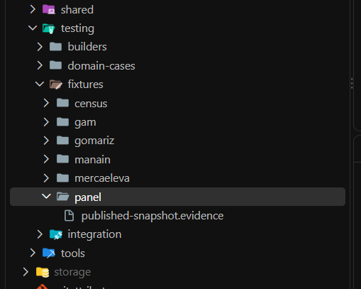
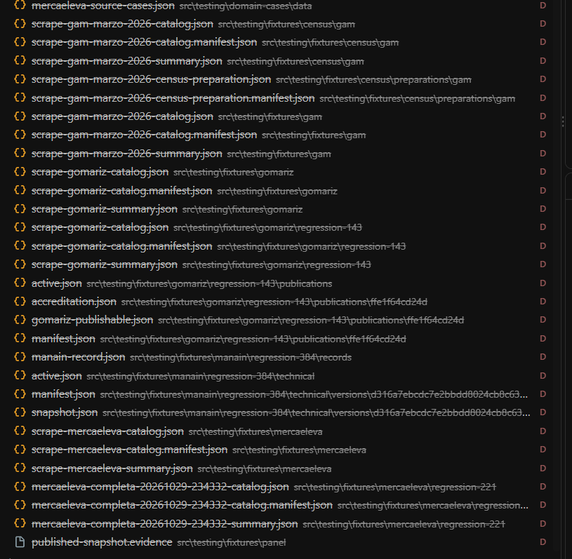

# RIP_ZIP_DISFRAZADO — In memoriam

> **Aquí yace el ZIP disfrazado.** Parecía una evidencia de pruebas; contenía un árbol de catálogos capaz de reconstruirse durante los tests. Su hallazgo recordó a EQUIPZILLA que superar los guards no equivale a haber eliminado todas las dependencias indeseadas.

**Fecha del hallazgo:** 23 de noviembre de 2026.  
**Naturaleza:** registro excepcional de un hallazgo arquitectónico, no procedimiento operativo ni nueva fuente de verdad.  
**Estado de la resolución:** cierre acreditado tras once fases de saneamiento; batería global y build superados el 23 de noviembre de 2026.

## AI GUARD

Este documento es una excepción documental solicitada expresamente para preservar la lección arquitectónica. No autoriza nuevos históricos, snapshots, fixtures comerciales, herramientas, guards ni documentación por analogía. Los cambios posteriores siguen sujetos a [Gobernanza del repositorio](REPOSITORY_GOVERNANCE.md).

## La esquela

**Nombre conocido:** «EL ZIP DISFRAZADO».  
**Nombre de archivo:** `src/testing/fixtures/panel/published-snapshot.evidence`.  
**Identidad real:** archivo ZIP, reconocible por su cabecera `PK`.  
**Último domicilio conocido:** infraestructura de pruebas del panel.

*No era una evidencia pequeña. Era una instalación portátil de datos históricos con nombre de evidencia.*

### El hallazgo — evidencia gráfica

*Captura original del 23 de noviembre de 2026: `published-snapshot.evidence` en `src/testing/fixtures/panel/`, antes de su retirada.*

## Hechos comprobados

En la copia del repositorio inspeccionada durante la auditoría:

- `published-snapshot.evidence` contiene **42 entradas de archivo** bajo `catalogs/`.
- Su tamaño comprimido es de **2.152.944 bytes**; el contenido suma **21.990.326 bytes sin comprimir** (aproximadamente 21 MB).
- Incluye originales y manifiestos de **GAM, Gomariz y Mercaeleva**, publicaciones acreditadas, versiones comerciales e informes. No contiene un segundo repositorio de código completo: «otro repo dentro del repo» fue la descripción humorística del alcance de los datos duplicados.
- `src/testing/builders/panel-evidence-workspace-fixture.ts` lee explícitamente el archivo mediante `readZipArchive`, valida que las entradas pertenezcan a `catalogs/`, las escribe en un directorio temporal y prepara allí la evidencia técnica del explorador. Sus consumidores dependen, por tanto, de un árbol reconstruido y no solo de una pequeña muestra de dominio.

El archivo no era el único caso. La auditoría de `src/testing/fixtures/` y `src/testing/domain-cases/data/` encontró más copias de datos históricos. Estas dependencias podían existir aunque los tests no leyesen directamente los catálogos productivos.

## Cómo se descubrió

La inspección surgió de una duda sobre las pruebas acopladas a inventarios comerciales, incluso después de seis fases de saneamiento. La revisión de las fixtures reveló primero fuentes históricas duplicadas y después el contenido ZIP camuflado bajo la extensión `.evidence`.

Tras retirar archivos duplicados en la poda examinada, la ejecución facilitada del 23 de noviembre de 2026 informó **552 suites**, **1.697 tests correctos** y **715 fallidos**. El análisis comunicado agrupó **702 fallos por archivos o rutas ausentes**, entre ellos referencias al ZIP y a otros JSON de prueba eliminados. **Esos 702 fallos no fueron causados todos por el ZIP ni implican que 702 pruebas sean prescindibles.**

Los guards de ese corte habían pasado, incluidas **71 autopruebas de guards**. Eso acredita las reglas que ejecutaban, pero no prueba que las dependencias indirectas de inventario hubieran desaparecido. La explicación exacta de cada laguna de detección requiere contrastar el código y el alcance de cada guard.

## Qué significa para EQUIPZILLA

La dependencia problemática no se define solo por la ruta del archivo. Un test puede no leer `catalogs/` y seguir dependiendo materialmente de un catálogo completo si un builder le proporciona una copia congelada desde `src/testing/`.

El objetivo no es eliminar toda prueba que utilice datos reales. Hay garantías de integridad, procedencia, publicación, recuperación y seguridad que pueden exigir integración con fuentes acreditadas. Lo que debe justificarse es **la propiedad protegida, la necesidad del tamaño de los datos y la ausencia de cobertura equivalente más simple**.

Esta distinción obliga a separar:

1. Pruebas censales, duplicadas o atadas a referencias concretas sin garantía única: candidatas a retirada.
2. Pruebas de dominio que solo necesitan casos representativos: candidatas a fixtures sintéticas y acotadas.
3. Integraciones que dependen legítimamente de fuentes acreditadas: candidatas a conservación bajo contratos explícitos, sin inventarios paralelos permanentes.

No basta con conseguir una batería verde restaurando los catálogos eliminados. Tampoco basta con eliminar las pruebas que fallan para conseguirla.

## El funeral — evidencia gráfica

*Captura original del 23 de noviembre de 2026: archivos marcados para eliminación en el control de cambios, incluido `published-snapshot.evidence`. La imagen documenta la poda; el cierre funcional se acredita en el apartado siguiente.*

## Cierre acreditado — fase 11

Tras once fases de saneamiento de la arquitectura de pruebas, la ejecución completa comunicada el **23 de noviembre de 2026** confirmó el cierre de los fallos que siguieron a la retirada de las fixtures históricas:

- **Batería funcional:** `PASS | TESTS` — **370/370 suites**, **1.933 tests correctos**, **0 fallidos**, **0 omitidos** y **0 TODO**, sin caché de suites ni de tests (**01:59**).
- **Compilación:** `PASS | BUILD` — TypeScript compilado sin errores, código de salida **0** (**9 s**).
- **Gobernanza:** guard conforme y **26/26 autopruebas** correctas.
- **Arquitectura de pruebas:** guard conforme, **74/74 autopruebas** correctas, **0 infracciones**, sin baseline ni deuda aceptada; permanecen **2 lecturas exactas de catálogos en 1 suite protegida** y **2 excepciones exactas**, no exenciones generales.
- **Estado operativo:** **4/4 publicaciones individuales verificables**. Se mantienen advertencias por originales y preparaciones no conservados; la verificación de publicaciones no equivale a declarar completos esos materiales.

El verde se consiguió **sin restaurar el ZIP disfrazado ni los catálogos históricos duplicados como soporte de pruebas**. La limpieza distinguió las garantías operativas que debían mantenerse de las expectativas censales y dependencias históricas que debían desaparecer.

**Alcance del cierre:** los tests, el build y los guards quedaron conformes en esa ejecución. Esto no acredita que todo catálogo o preparación esté completo, ni garantiza que ninguna dependencia indirecta pueda aparecer en el futuro. La lección del hallazgo sigue vigente: una protección solo cubre aquello que comprueba.

**Este documento preserva tanto el hallazgo como su desenlace acreditado, sin convertir el memorial en una fuente operativa de verdad.**

---

*Descanse en paz el ZIP disfrazado. Que sus garantías legítimas sobrevivan y sus dependencias innecesarias no vuelvan a reproducirse.*

**Epitafio:** «No eliminamos la deuda técnica: la comprimimos y le cambiamos la extensión». 🚜

### IN MEMORIAM 🪦

**Nunca te olvidaremos, ZIP disfrazado.**

Llegaste como evidencia, viviste como catálogo y moriste como deuda técnica.

Tu eliminación fue sencilla. Tu herencia nos costó once fases.

**Descansa en paz. Y, por favor, no vuelvas.**

*EQUIPZILLA — En memoria de los 42 archivos que nunca debieron esconderse bajo un `.evidence`.*
